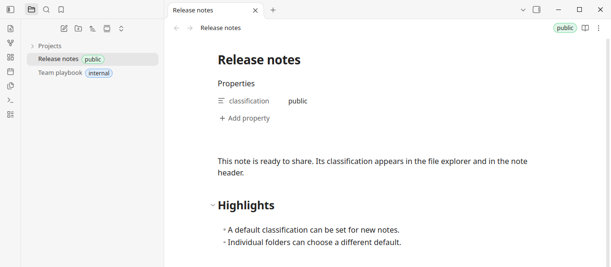
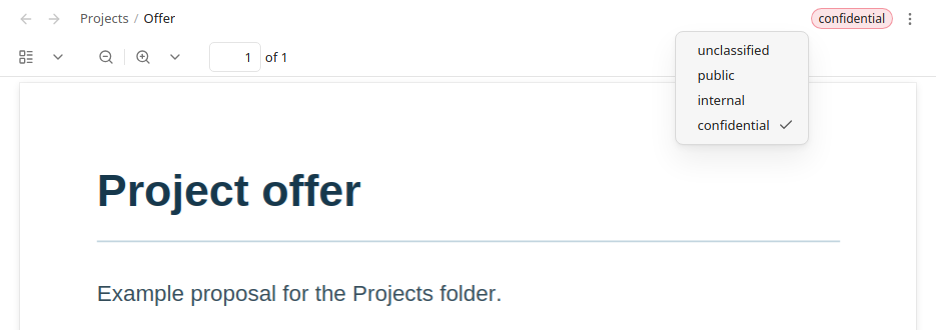
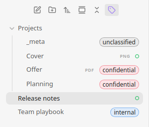

# Classificator

Classificator helps you label Markdown notes and attachments in Obsidian’s file explorer and in the header of an open file. The default values are `unclassified`, `public`, `internal`, and `confidential`.

Classificator’s role is limited to saving and displaying the label. It saves a note’s classification as the `classification` property in its YAML frontmatter. Scripts and other plugins can read it and decide how to use it. For example, Langdock Sync uses the property to determine which notes are eligible for synchronization. [Langdock Sync documentation](https://github.com/nblum/obsidian-langdock-sync#freigabe-und-abgleich)



## Installation

Classificator requires Obsidian Desktop 1.7.4 or later. Copy `manifest.json`, `main.js`, and `styles.css` from a GitHub release or a local build to `.obsidian/plugins/classificator/` in your vault. Then enable **Classificator** under **Settings → Community plugins**. [GitHub releases](https://github.com/nblum/obsidian-classificator/releases)

## Introduction and plugin information

On first launch, Classificator walks you through classifying notes, choosing defaults, and setting folder rules. **Show introduction** and **About Classificator** are available in settings and in the command palette.

The top of the settings tab shows the plugin version, author, and links to documentation, the repository, and feedback. Classificator shows the save status when you change a setting. [Settings](assets/screenshots/settings.png) · [Introduction](assets/screenshots/introduction.png) · [About Classificator](assets/screenshots/about.png)

## Language

Classificator follows Obsidian’s language by default. Under **Settings → Classificator → Language**, you can choose German, English, French, Italian, Spanish, Dutch, Brazilian or European Portuguese, or Simplified Chinese. Classificator uses English for other Obsidian languages.

## Classify notes

Under **Settings → Classificator → New notes**, choose what happens when you create an empty Markdown note.

| Mode | Behavior |
| --- | --- |
| **Apply default value** | Sets the chosen classification. The default is `unclassified`. |
| **Ask when creating a note** | Opens the classification picker. Choose **Skip** to leave the property unset. |
| **Classify manually only** | Lets you classify the note when needed. |

The new-note modes apply to empty Markdown files and skip `_meta.md`. If you create a note with content or from a template, you can classify it manually afterward.

Obsidian saves a note’s classification as a property at the top of the file. You can edit it directly in **Properties** or in Source mode.

```yaml
---
classification: internal
---
```

## Change a classification

1. Open a note or attachment in Obsidian. Click its current classification or **Classify** in the header at the top right. You can also click its text badge or color dot in the file explorer.
2. Choose a value from the menu. A check mark identifies the current value. Classificator saves your selection immediately and updates the badges.



To set a classification from the file explorer, right-click the file and choose **Classify note** or **Classify attachment**. Pick a value and click **Save**. For an open Markdown note, **Classificator: Classify active note** in the command palette opens the same picker.

You can also [change the values offered in the picker](#appearance-and-classifications) in Classificator settings.

## File explorer

In Obsidian’s left sidebar, open **Files** using the folder icon. Classificator displays text badges and color dots at the right edge of the file rows. Attachment rows also show the file extension.



- Click a badge or dot to choose a classification without opening the file. Hover over a dot to read its value.
- Click the tag icon in the toolbar above the file tree to toggle all badges and dots in the explorer. The file header has its own text badge, and Classificator remembers the explorer setting for each vault.
- To apply one value to several files, select their rows and right-click one of the selected files. Choose **Classify selected notes**, or **Classify selected files** if the selection includes an attachment. Pick a value and open **Preview changes**. Expand the groups for new values, overwrites, and skips to review the files. Click **Apply changes** to save the batch. Folders, `_meta.md`, and files whose path or classification changed after the preview are skipped.

## Classify attachments

Classify PDFs, images such as PNG, JPG, or SVG, audio such as MP3, and video such as MP4 directly from the file explorer. For attachments you open in an Obsidian tab, such as a PDF or image, the **Classify** button or current classification in the header opens the same quick menu as for a note. [File types Obsidian can open](https://obsidian.md/help/file-formats)

For DOCX, XLSX, ZIP, and other files that Obsidian can list without opening them in a tab, turn on **Settings → Files and links → Show all file types**. Older Obsidian versions call this **Detect all file extensions**. Right-click the file in the explorer and choose **Classify attachment**. [Obsidian Files and links settings](https://obsidian.md/help/settings#Show%20all%20file%20types)

Classificator stores a separate value for each attachment, including those embedded in notes. It saves the value in the YAML frontmatter of `_meta.md` in the same folder. The `attachment-classifications` mapping uses full filenames, including the extension. Edit the mapping in Source mode to adjust values directly.

```yaml
---
classification: internal
attachment-classifications:
  Offer.pdf: confidential
  Cover.png: public
---
```

The top-level `classification` is the folder’s default for new notes. In Classificator, `_meta.md` itself always counts as `unclassified`. Integrations reading YAML directly should skip `_meta.md` when reading individual note classifications.

Classificator updates the attachment entry when it sees an Obsidian rename or move and removes it when it sees a deletion. A move to another folder stores the entry in the destination’s `_meta.md`. Folder defaults and the new-note modes apply to Markdown notes.

## Classification overview

Open **Classificator: Classification overview** from the command palette to find notes with missing or empty classifications, notes explicitly set to `unclassified`, and notes with unknown values. Unknown values include classifications removed from settings and properties stored in a format other than text. Filter by status and folder, including that folder’s subfolders. Select a result to open the note.

## Folder rules

Right-click a folder in the file explorer and choose **Classificator: Folder rules** to set its default classification. Classificator saves the rule in the folder’s `_meta.md`. You can also edit that file directly.

```yaml
---
classification: confidential
---
```

In **Apply default value** mode, a folder’s `classification` takes precedence over the global default for new empty notes. Enable **Inherit folder rules** in Classificator settings to let folders without a rule use the nearest ancestor’s rule, including a rule at the vault root. The folder dialog shows the inherited value and its source. Classificator uses the global default when no applicable folder provides a rule. If the applicable rule contains an unconfigured value, automatic classification skips the note until the rule is corrected.

Select **Save default** beside the classification picker to save the default for future notes. To remove the folder’s own rule, choose **Global** or **Inherited from** before saving. The dialog stays open so you can also update existing notes.

Under **Existing notes**, choose the scope and which notes to update, then select **Preview changes**. By default it considers notes directly in the folder with a missing, empty, or `unclassified` value. You can include subfolders or switch to all notes. For a recursive batch, the selected value applies throughout the scope, including subfolders with their own rule. Select **Apply changes** in the preview to update the notes.


## Appearance and classifications

Open **Settings → Classificator → Classifications** to change the choices in the picker and their appearance.

- Use **New classification** to enter a value such as `restricted`, then click **Add**.
- For each value, choose its **Color** and its appearance in the file explorer. The available styles are **Text badge**, **Color dot**, and **Hidden**.
- To replace a value, add the new one, reclassify the affected files, then use the trash icon to remove the old value from the picker. Notes that still have the old value appear under **Unknown classification** in the classification overview.

If you upgrade from a version with a global explorer style, existing classifications start with that style.

## Development and testing

Development requires Node.js 24. The build generates `main.js` in the project directory for manual installation.

```sh
npm ci
npm run build
```

```sh
npm test
npm run test:e2e
```

`npm test` checks release metadata and translations. The end-to-end tests use a temporary vault to verify classification, folder rules, preservation of note content and properties, settings, and help dialogs. See the contributor guide for Linux prerequisites and documentation screenshots. [CONTRIBUTING.md](CONTRIBUTING.md)
