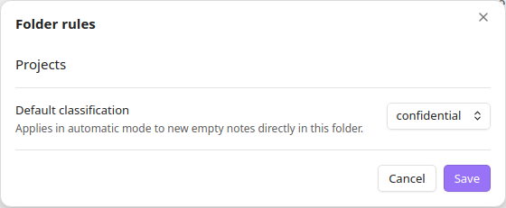

# Classificator

Classificator speichert die Einstufung einer Markdown-Notiz als Obsidian-Eigenschaft `classification`. Du kannst sie im Dateibaum und im Notizkopf anzeigen lassen. Voreingestellt sind `unclassified`, `public`, `internal` und `confidential`.


## Installation

Classificator setzt Obsidian Desktop 1.7.4 oder neuer voraus. Kopiere `manifest.json`, `main.js` und `styles.css` aus einem GitHub-Release oder deinem lokalen Build nach `.obsidian/plugins/classificator/` in deinem Vault. Aktiviere anschließend **Classificator** unter **Einstellungen → Community-Plugins**. [GitHub-Releases](https://github.com/nblum/obsidian-classificator/releases)

## Einführung und Plugin-Infos

Beim ersten Start führt Classificator durch die Einstufung von Notizen, Standardwerte und Ordnerregeln. **Einführung anzeigen** und **Über Classificator** findest du in den Einstellungen und in der Befehlspalette.

Oben in den Einstellungen stehen die Plugin-Version, der Autor und Links zu Dokumentation, Repository und Feedback. Beim Ändern einer Einstellung zeigt Classificator den Speicherstatus an. [Einstellungen](assets/screenshots/settings.png) · [Einführung](assets/screenshots/introduction.png) · [Über Classificator](assets/screenshots/about.png)

## Sprache

Classificator übernimmt standardmäßig die Sprache von Obsidian. Unter **Einstellungen → Classificator → Sprache** kannst du Deutsch, Englisch, Französisch, Italienisch, Spanisch, Niederländisch, brasilianisches oder europäisches Portugiesisch sowie vereinfachtes Chinesisch wählen. Für weitere Obsidian-Sprachen verwendet Classificator Englisch.

## Notizen einstufen

Unter **Einstellungen → Classificator → Neue Notizen** wählst du, was beim Anlegen einer leeren Markdown-Notiz passiert.

| Modus | Verhalten |
| --- | --- |
| **Standardwert einsetzen** | Trägt die gewählte Einstufung ein. Voreingestellt ist `unclassified`. |
| **Bei neuer Notiz nachfragen** | Öffnet die Auswahl. Mit **Überspringen** bleibt die Notiz ohne Einstufung. |
| **Nur manuell einstufen** | Du stufst die Notiz bei Bedarf selbst ein. |

Die Modi für neue Notizen gelten für leere Markdown-Dateien mit Ausnahme von `_meta.md`. Wenn du eine Notiz mit Inhalt oder mit einer Vorlage anlegst, kannst du die Einstufung anschließend manuell setzen.

Verwende dazu den Badge im Notizkopf, den Eintrag **Notiz einstufen** im Datei-Kontextmenü oder **Aktuelle Notiz einstufen** in der Befehlspalette. Obsidian speichert den gewählten Wert am Anfang der Datei.

```yaml
---
classification: internal
---
```

## Ordnerregeln

Öffne im Dateibaum per Rechtsklick auf einen Ordner **Classificator: Ordnerregeln**. Dort legst du die Standardeinstufung fest. Classificator speichert sie in der `_meta.md` des Ordners. Du kannst die Datei auch direkt bearbeiten.

```yaml
---
classification: confidential
---
```

`classification` hat im Modus **Standardwert einsetzen** Vorrang vor dem globalen Standardwert. Wähle dafür eine in Classificator konfigurierte Einstufung. Die Regel gilt für neue leere Notizen direkt in diesem Ordner.

**Global** im Ordnerdialog entfernt `classification` aus `_meta.md`. Ordner ohne eigene Einstufung verwenden den globalen Standardwert.



## Darstellung und Einstufungen

In den Classificator-Einstellungen kannst du die Badges im Dateibaum und im Notizkopf unabhängig voneinander ein- oder ausschalten. Im Dateibaum stehen **Text-Badge** und **Farbpunkt** zur Auswahl. Beim Farbpunkt zeigt der Tooltip die Einstufung an.

Unter **Einstufungen** kannst du eigene Werte hinzufügen, Farben ändern und Werte aus der Auswahl entfernen. Bereits in Notizen gespeicherte Werte bleiben dabei erhalten.

## Entwicklung und Tests

Voraussetzung ist Node.js 24. Der Build erzeugt `main.js` im Projektverzeichnis für die manuelle Installation.

```sh
npm ci
npm run build
```

```sh
npm test
npm run test:e2e
```

`npm test` prüft die Release-Metadaten und Übersetzungen. Die E2E-Tests laufen in einem temporären Vault und prüfen Einstufung, Ordnerregeln, den Erhalt von Notizinhalt und Eigenschaften sowie die Einstellungen und Hilfedialoge. Die Linux-Voraussetzungen und der separate Lauf für Doku-Screenshots stehen in [CONTRIBUTING.md](CONTRIBUTING.md).
